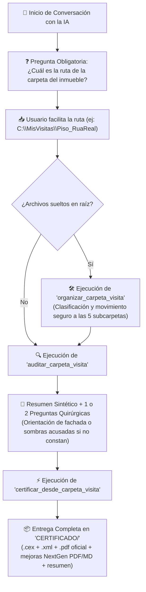

# 📁 Guía Oficial de Arquitectura de Carpetas y Flujo de Visita CE3X

> [!IMPORTANT]
> Esta especificación define el estándar canónico de estructuración de archivos para inmuebles a certificar energéticamente mediante el servidor **CE3X-MCP-Server**.

---

## 🏗️ Las 5 Subcarpetas Estándar del Inmueble

Cada vivienda o edificio analizado dispone de un directorio raíz (por ejemplo, `C:\Visitas\Piso_RuaReal\`) que se estructura en **5 subcarpetas clave**:

| Subcarpeta | Finalidad Técnica | Tipos de Archivo Admitidos |
| :--- | :--- | :--- |
| **`📁 INFORMACION/`** | Notas de visita, Referencia Catastral, apuntes, datos del titular o recibos del IBI. | `.txt`, `.md`, `.doc`, `.docx`, `.json`, `.csv`, `.pdf` (notas) |
| **`📁 PLANOS/`** | Planos arquitectónicos de distribución, plantas, alzados, croquis acotados y modelos BIM. | `.pdf` (planos acotados), `.ifc` (BIM), `.dwg`, `.dxf` |
| **`📁 FOTOS/`** | Fotografías generales del inmueble (fachada exterior, carpinterías/ventanas, vistas y sombras). | `.jpg`, `.jpeg`, `.png`, `.webp`, `.bmp`, `.heic` |
| **`📁 INSTALACIONES/`** | Fotos de placas de características de calderas, termos eléctricos, bombas de calor y fichas técnicas. | `.jpg`, `.jpeg`, `.png` (placas), `.pdf` (fichas técnicas equipos) |
| **`📁 CERTIFICADO/`** | **Carpeta oficial de salida.** Depósito exclusivo donde la IA genera automáticamente los entregables. | `.cex`, `.xml`, `.pdf` informe, `.pdf` y `.md` mejoras NextGen |

---

## 🤖 Protocolo de Interacción con la IA (Paso a Paso)

---

## 📦 Entregables Generados en `CERTIFICADO/`

Al finalizar el proceso, la subcarpeta `CERTIFICADO/` contiene exactamente:

1. **`Proyecto_CE3X.cex`**: Archivo de proyecto nativo listo para abrir directamente en la interfaz gráfica de CE3X v3.2.
2. **`Certificado_Oficial_Registro.xml`**: Archivo XML oficial v3.0 validado contra el esquema RelaxNG del Ministerio para su registro telemático ante el órgano competente de la Comunidad Autónoma.
3. **`Informe_Certificacion_Energetica.pdf`**: Documento oficial de 15 páginas compilado mediante el motor oficial `xml2cert` (Typst).
4. **`Informe_Medidas_Mejora_NextGen.pdf`**: Dictamen técnico de medidas de mejora del RD 390/2021 y subvenciones del Plan de Recuperación NextGen (RD 853/2021) maquetado profesionalmente en PDF.
5. **`Informe_Medidas_Mejora_NextGen.md`**: Dictamen técnico completo en formato Markdown editable.
6. **`RESUMEN_ENTREGA.txt`**: Ficha ejecutiva con los datos clave, calificación (letra global, emisiones de CO2, consumo de EPnr) y resumen de ayudas públicas estimadas.

---

> [!TIP]
> Si depositas todos los archivos de golpe en la raíz de una carpeta sin clasificar, no te preocupes: al conectar con la IA, el servidor los clasifica y ordena automáticamente sin que tengas que moverlos a mano.

---

*Jose Manuel Caamaño González | Arquitecto Técnico & BIM Manager*  
*A Coruña, Galicia. Hecho con código y café. ☕*
