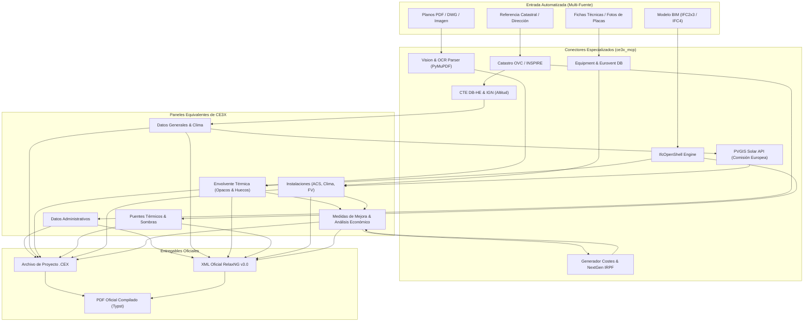
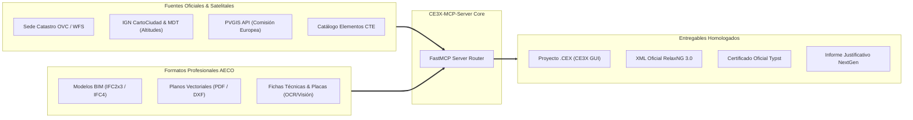

# 🌐 Estudio Exhaustivo de Conectores, Conexiones y Automatización Integral: CE3X-MCP-Server

---

## 1. Visión Estratégica: De Software Manual a Cerebro Autónomo ConTech

### 1.1. El Problema del Flujo Tradicional en CE3X
En la práctica profesional de la Arquitectura Técnica y la Ingeniería de Edificación, realizar un Certificado de Eficiencia Energética (CEE) mediante la interfaz gráfica de CE3X v3.2 requiere un proceso farragoso, lento y propenso a errores humanos:
* Localizar manualmente el inmueble en la Sede del Catastro y copiar referencias, superficies y año.
* Consultar las tablas del CTE DB-HE para determinar la zona climática según altitud del municipio.
* Medir manualmente sobre planos de planta o croquis en obra los metros cuadrados de fachadas, cubiertas, medianerías y particiones interiores.
* Calcular a mano las áreas de huecos, restar la superficie de ventanas a las fachadas y deducir porcentajes de marco.
* Estimar o consultar catálogos para averiguar la transmitancia $U$ de carpinterías y vidrios antiguos.
* Calcular o aceptar longitudes genéricas de puentes térmicos.
* Buscar la ficha técnica del fabricante de la caldera o bomba de calor para determinar su potencia nominal y rendimiento estacional (SCOP/COP/SEER).
* Proponer manualmente las medidas de mejora en el programa, reescribiendo descripciones y estimando costes "a ojo".
* Exportar el XML oficial, compilar el PDF y luego firmarlo con AutoFirma para subirlo a la plataforma autonómica.

### 1.2. La Solución: El Super-Agente MCP Oficial (`CE3X-MCP-Server`)
El objetivo de **CE3X-MCP-Server** es transformar este proceso en una experiencia **ultrarrápida, rigurosa y 100% automatizada** conectando modelos de lenguaje (Claude, Gemini, Cursor) con:
1. **Bases de datos oficiales y satelitales** (Catastro, IGN, PVGIS de la Comisión Europea).
2. **Motores de lectura geométrica y BIM** (`IfcOpenShell` para IFC, `PyMuPDF` + Visión para planos PDF/DWG).
3. **Catálogos normativos y de mercado** (Catálogo de Elementos Constructivos del CTE, bases de datos ERP de fabricantes).
4. **Bases de precios y algoritmos financieros** (Costes de mercado tipo CYPE/BEDEC y cálculo de deducciones IRPF y ayudas Next Generation EU según RD 853/2021).
5. **Motores de generación homologados** (Serializador `.cex`, Validador RelaxNG oficial del Ministerio y Compilador Typst / `xml2cert`).

---

## 2. Mapeo Exhaustivo Pantalla por Pantalla, Botón por Botón y Función por Función

A continuación se detalla la correspondencia técnica entre **cada elemento de la interfaz y manuales de CE3X v3.2** y el **conector o pipeline automatizado** diseñado para el MCP.



---

### 2.1. Panel "Datos Administrativos"

| Elemento / Botón en CE3X | Parámetros que solicita | Conector Automatizado en el MCP | Fuente de Datos / API |
| :--- | :--- | :--- | :--- |
| **Identificación del Edificio** | Nombre del edificio, Dirección, Municipio, Provincia, Código Postal. | `services/catastro.py` $\rightarrow$ `consultar_catastro_por_rc()` | **API OVC Catastro**: A partir de la Referencia Catastral o dirección normalizada, extrae automáticamente todos los campos oficiales del inmueble. |
| **Referencia Catastral** | 20 dígitos o identificador foral (Álava, Bizkaia, Gipuzkoa, Navarra). | `services/catastro.py` $\rightarrow$ Validador sintáctico y de dígito de control del Catastro. | Sede Electrónica del Catastro de España y Registros Forales. |
| **Alcance de la Certificación** | Edificio completo, Vivienda individual en bloque, Local terciario. | Clasificación automática por semántica: si el Catastro indica uso residencial con número de planta y puerta (ej. 3ºB) $\rightarrow$ `ViviendaIndividual`; si es parcela completa sin división horizontal $\rightarrow$ `EdificioCompleto`. | Metadatos catastrales (`tipo_inmueble`, `coeficiente_participacion`). |
| **Datos del Técnico Certificador** | Nombre, DNI/NIF, Razón social, Titulación (Arquitecto Técnico / Aparejador / Arquitecto / Ingeniero), Colegio Oficial, Nº de colegiado, Contacto. | `core/user_profile.py` $\rightarrow$ Perfil técnico persistente configurado en el archivo local de configuración del MCP (`~/.ce3x_mcp/config.yaml`). | Configuración del usuario en el entorno local (se introduce una sola vez y se reutiliza para todos los certificados). |

---

### 2.2. Panel "Datos Generales"

| Elemento / Botón en CE3X | Parámetros que solicita | Conector Automatizado en el MCP | Fuente de Datos / API |
| :--- | :--- | :--- | :--- |
| **Localización y Clima** | Provincia, Municipio, Altitud sobre el nivel del mar ($m$). | `services/cte_climate.py` $\rightarrow$ `obtener_zona_climatica(provincia, municipio, altitud)` | **CTE DB-HE Apéndice B + API CartoCiudad / IGN**: Obtiene la altitud topográfica exacta del punto geográfico y determina la zona climática oficial ($\alpha1$ a $E1$). |
| **Normativa Vigente de Construcción** | Anterior a 1979 (sin aislamiento obligatorio), NBE-CT-79 (aislamiento básico), CTE 2006, CTE 2013, CTE 2019. | Inferencia automática según el año de construcción catastral: $< 1981 \rightarrow$ Anterior a 1979; $1981-2007 \rightarrow$ NBE-CT-79; $2007-2014 \rightarrow$ CTE 2006; $2014-2020 \rightarrow$ CTE 2013; $> 2020 \rightarrow$ CTE 2019. | Catastro (campo `antiguedad_inmueble`). |
| **Definición Geométrica** | Superficie útil habitable ($m^2$), Altura libre media ($m$), Número de plantas, Volumen acondicionado ($m^3$). | 1. **Modo Directo:** Valor del usuario o superficie catastral multiplicada por factor útil (0.85).<br>2. **Modo Plano:** Extracción automática mediante polígonos de estancias con OpenCV / PyMuPDF.<br>3. **Modo BIM:** Cubicación de entidades `IfcSpace` con `ifcopenshell`. | Catastro / Planos PDF / Modelo BIM IFC. |
| **Tasa de Ventilación e Infiltración** | Renovaciones de aire por hora ($ren/h$) o caudal en $m^3/h$. | Cálculo automático según CTE DB-HS3: para residencial aplica $0.63\ ren/h$ (vivienda estándar); si se aporta ensayo *Blower Door*, aplica el valor ensayado $n_{50}$. | CTE DB-HS3 / Informe de ensayo de estanqueidad. |
| **Masa e Inercia Térmica** | Baja, Media, Alta. | Inferencia por tipología constructiva: estructura de hormigón/forjado unidireccional y tabiquería de ladrillo $\rightarrow$ Inercia Media ($200\ kg/m^2$); construcción en entramado ligero/madera $\rightarrow$ Baja; muros de mampostería de piedra antigua $\rightarrow$ Alta. | Año y tipología constructiva regional. |

---

### 2.3. Panel "Envolvente Térmica: Cerramientos Opacos"

CE3X divide la envolvente en botones específicos según la posición y el contacto térmico de cada elemento:

| Botón en CE3X | Parámetros que solicita | Conector Automatizado en el MCP | Base Normativa / Datos |
| :--- | :--- | :--- | :--- |
| **Fachada con Aire Exterior** | Nombre, Orientación (N, S, E, O, etc.), Longitud ($m$), Altura ($m$), Superficie ($m^2$), Transmitancia $U$ ($W/m^2K$), Masa ($kg/m^2$). | `services/plan_parser.py` (Planos) o `services/bim_parser.py` (`IfcWall` donde `IsExternal = True`). Asignación de $U$ según año y zona climática o por composición de capas. | Catálogo de Elementos Constructivos del CTE (CEC-CTE). |
| **Fachada en Contacto con Terreno (Muros enterrados)** | Superficie ($m^2$), Profundidad de enterramiento ($m$), Transmitancia del muro y terreno. | `services/bim_parser.py` (`IfcWall` con contacto terreno) o inferencia automática si la vivienda está en planta semisótano. | Fórmulas UNE-EN ISO 13370 de transmisión por el terreno. |
| **Medianería / Fachada con Edificio** | Superficie ($m^2$), Condición de edificio colindante (habitado o similar temperatura $\rightarrow$ cerramiento adiabático). | Detección geométrica en planos: muros compartidos sin ventanas en linderos de parcela. Transmitancia $U=0$ (adiabático) para cálculo de demanda. | Planos de situación / Cartografía catastral (parcelario contiguo). |
| **Cubierta con Aire Exterior (Plana / Inclinada)** | Superficie ($m^2$), Inclinación, Transmitancia $U$ ($W/m^2K$). | Detección de última planta o entidad `IfcSlab` con predefinición `ROOF`. $U$ estimada según normativa (ej. NBE-CT-79: $U=1.10\ W/m^2K$; CTE 2019: $U=0.28\ W/m^2K$). | Manual Fundamentos CE3X / CTE DB-HE. |
| **Suelo con Terreno (Solera)** | Superficie ($m^2$), Perímetro expuesto ($m$), Aislamiento perimetral. | Detección de planta baja en contacto con suelo o entidad `IfcSlab` con predefinición `BASESLAB`. | UNE-EN ISO 13370 / CTE DB-HE. |
| **Suelo con Aire Exterior (Voladizos)** | Superficie ($m^2$), Transmitancia $U$ ($W/m^2K$). | Detección de forjados en voladizo sobre porches o pasos exteriores. | Detección en planos de forjados sobre espacio exterior. |
| **Particiones Interiores (Verticales / Horizontales)** | Cerramientos en contacto con espacios no habitables (garajes, trasteros, cajas de escalera). Coeficiente de reducción de temperatura $b$. | Estimación según CTE DB-HE: $b=0.80$ para trasteros/garajes no ventilados; $b=0.90$ si están ventilados. | Tabla 5 del Manual de Fundamentos Técnicos CE3X. |

---

### 2.4. Panel "Envolvente Térmica: Huecos y Lucernarios"

| Elemento / Botón en CE3X | Parámetros que solicita | Conector Automatizado en el MCP | Fuente de Datos / Inferencia |
| :--- | :--- | :--- | :--- |
| **Dimensiones y Orientación** | Longitud ($m$), Altura ($m$), Multiplicador, Orientación, Cerramiento asociado. | `services/plan_parser.py` (Cuadro de carpinterías en planos) o `services/bim_parser.py` (`IfcWindow` / `IfcDoor`). Resta automáticamente el área de huecos de la fachada opaca asociada. | Planos arquitectónicos / Modelo BIM. |
| **Tipo de Vidrio** | Simple (monolítico), Doble estándar, Doble bajo emisivo con argón, Triple. | Inferencia por año de construcción o reconocimiento visual en fotos de ventanas (lectura del perfil intercalario con OCR de doble acristalamiento tipo Climalit/Guardian Sun). | Base de datos de vidrios CE3X (`menuVidrios.pyd`). |
| **Tipo de Marco** | Metálico sin RPT, Metálico con RPT (4-12mm / >12mm), Madera, PVC (2-3 cámaras / >3 cámaras). | Extracción de fichas técnicas de carpintería o clasificación automática mediante visión artificial de fotografías de carpinterías. | Base de datos de marcos CE3X (`menuMarcos.pyd`). |
| **Permeabilidad al Aire** | Clase 1 (100 $m^3/hm^2$), Clase 2 (50 $m^3/hm^2$), Clase 3 (27 $m^3/hm^2$), Clase 4 (9 $m^3/hm^2$). | Por defecto según época: Anterior a 1979 $\rightarrow$ Clase 1; NBE-CT-79 $\rightarrow$ Clase 2; CTE 2006/2013 $\rightarrow$ Clase 3; CTE 2019 / Ventanas modernas con junta perimetral estanca $\rightarrow$ Clase 4. | Norma UNE-EN 12207. |
| **Dispositivos de Sombra** | Voladizos, retranqueos, lamas horizontales/verticales, toldos, persianas. | Cálculo trigonométrico automatizado de factores de sombra $F_s$ en función de la orientación cardinal y dimensiones geométricas del retranqueo o alero. | Fórmulas de sombras del CTE DB-HE Apéndice E. |

---

### 2.5. Panel "Puentes Térmicos" y "Patrones de Sombra"

| Elemento / Botón en CE3X | Parámetros que solicita | Conector Automatizado en el MCP | Algoritmo / Base de Datos |
| :--- | :--- | :--- | :--- |
| **Puentes Térmicos (PT)** | Encuentro fachada-forjado, esquinas entrantes/salientes, contorno de huecos, cajas de persiana, pilares en fachada. Longitud ($m$) y transmitancia lineal $\psi$ ($W/mK$). | 1. **Modo Automático:** Correlación estadística oficial de CE3X según tipología y superficie.<br>2. **Modo BIM:** Cubicación exacta de longitudes de aristas de encuentro forjado-muro y pilares con `ifcopenshell`. | Catálogo de Puentes Térmicos del CTE / Atlas de Puentes Térmicos IDAE. |
| **Patrones de Sombra** | Obstáculos remotos (edificios de enfrente, colinas). Ángulos de azimut y elevación. | Cálculo astronómico mediante coordenadas geográficas y alturas de edificios colindantes disponibles en la cartografía 3D de Catastro / PNOA. | Algoritmo de posición solar y geometría de obstáculos. |

---

### 2.6. Panel "Instalaciones Térmicas, Iluminación y Renovables"

| Elemento / Botón en CE3X | Parámetros que solicita | Conector Automatizado en el MCP | Base de Datos / API de Conexión |
| :--- | :--- | :--- | :--- |
| **Producción de ACS** | Demanda diaria ($l/día$ a 60°C), tipo de generador (caldera, termo, aerotermia), combustible, rendimiento estacional. | Cálculo de demanda según número de dormitorios CTE DB-HE ($28\ l/persona\cdot día$). Parser de fichas técnicas para extraer el COP/SCOP del equipo. | CTE DB-HE Tabla 4.1 + `equipment_parser.py`. |
| **Calefacción** | Tipo de caldera/bomba de calor, potencia nominal ($kW$), rendimiento nominal o estacional, temperatura de impulsión, cobertura (%). | `services/equipment_parser.py`: Detección en fotos de placa de características o texto de marca/modelo (ej. Saunier Duval Themafast, Daikin Altherma, etc.) y asignación de SCOP/EER. | Bases de datos oficiales Eurovent / Keymark / ERP. |
| **Refrigeración / Climatización** | Equipos de refrigeración, splits, VRF, potencia frigorífica ($kW$), rendimiento SEER. | Reconocimiento de equipos de aire acondicionado por marcado CE o etiquetas energéticas. | Directiva de Ecodiseño (ErP) y etiquetado energético UE. |
| **Energía Solar Térmica** | Superficie de captadores ($m^2$), orientación, inclinación, aporte solar cubierto (% o $kWh/año$). | Cálculo de producción solar térmica en función de la radiación solar media de la localidad. | Atlas de radiación solar del IDAE / PVGIS. |
| **Energía Solar Fotovoltaica** | Potencia pico instalada ($kWp$), producción anual generada ($kWh/año$), porcentaje de autoconsumo (%). | **API Oficial PVGIS (Comisión Europea)**: Envía latitud, longitud, inclinación (30°-45°) y orientación (Sur=0°) y devuelve la producción fotovoltaica real hora a hora ($kWh/año$) con datos satelitales SARAH-2. | **PVGIS API (JRC - Comisión Europea)**: `https://re.jrc.ec.europa.eu/api/v5_2/PVcalc`. |
| **Iluminación (Terciario)** | Potencia instalada ($W$), Valor de Eficiencia Energética de Instalación (VEEI en $W/m^2\cdot 100\ lux$), sistemas de regulación y control. | Verificación de cumplimiento CTE DB-HE3 según tipo de actividad y tipo de luminarias (fluorescencia, halogenuros, LED de alta eficiencia). | CTE DB-HE3. |

---

### 2.7. Panel "Medidas de Mejora de la Eficiencia Energética" y "Análisis Económico"

| Elemento / Botón en CE3X | Parámetros que solicita | Conector Automatizado en el MCP | Modelo de Inferencia y Fuentes |
| :--- | :--- | :--- | :--- |
| **Definición de Medidas (RD 390/2021)** | Descripción técnica del paquete de mejora: intervención en envolvente, equipos o energías renovables. | `services/improvement_engine.py`: Formula automáticamente los 3 paquetes exigidos por normativa (SATE en fachada, aerotermia para climatización y ACS, e instalación fotovoltaica con autoconsumo). | Guía IDAE de Medidas de Mejora + RD 390/2021. |
| **Recálculo de Calificación** | Demanda, consumo de energía primaria no renovable, emisiones de $CO_2$, nueva letra (salto a B o A). | Motor de recálculo instantáneo: recomputa el balance energético aplicando las nuevas transmitancias $U$ y rendimientos estacionales SCOP. | Fórmulas de balance térmico y escala de letras `Localidades.xml`. |
| **Inversión Estimada (€)** | Coste de ejecución material de cada medida de rehabilitación. | **Generador de Costes Paramétricos**: Base de precios de construcción actualizada (SATE $\approx 85-105\ €/m^2$; Ventanas PVC bajo emisivo $\approx 350-450\ €/m^2$; Aerotermia $\approx 7.000-10.000\ €$; FV 3 kWp $\approx 4.000-5.000\ €$). | Bases de precios de referencia del sector (CYPE / BEDEC). |
| **Ahorro Económico y Retorno (Payback / VAN)** | Facturación actual vs facturación mejorada (€/año), periodo de retorno simple y descontado. | Calcula el ahorro multiplicando los $kWh$ ahorrados por el precio medio de la electricidad ($0.16-0.20\ €/kWh$) y gas ($0.09-0.12\ €/kWh$). Calcula el Payback en años. | Precios del mercado energético (OMIE / CNMC). |
| **Justificación de Subvenciones y Deducciones IRPF** | Porcentajes de ahorro de energía primaria no renovable para acceder a ayudas públicas. | **Módulo Fiscal NextGen:**<br>- Ahorro $\ge 30\%\ \rightarrow$ Deducción IRPF del 40% (hasta 7.500 €) o Ayuda PREE 5000.<br>- Reducción demanda $\ge 7\%\ \rightarrow$ Deducción IRPF del 20%.<br>- Calificación A o salto de 2 letras en edificio $\rightarrow$ Deducción IRPF del 60% (hasta 15.000 €). | **Real Decreto 853/2021** (Programas Next Generation EU) y Ley del IRPF (D.A. 50ª). |

---

## 3. Catálogo Ampliado de Conectores Externos a Integrar

Para que `CE3X-MCP-Server` sea una herramienta inigualable en el mercado, se integrarán los siguientes conectores mediante microservicios y clientes Python:



### 3.1. Conector 1: Sede Electrónica del Catastro (API OVS & WFS INSPIRE)
* **Objetivo:** Obtener con 1 solo dato (la Referencia Catastral o la dirección) el 100% de la ficha administrativa del edificio: año de construcción, superficie construida, uso, número de plantas y coordenadas geográficas.
* **Endpoints:**
  - `http://ovc.catastro.meh.es/ovcservweb/ovcswlocalizacionrc/ovccallejero.asmx/Consulta_DNPRC`
  - WFS INSPIRE de parcelas catastrales: `http://ovc.catastro.meh.es/INSPIRE/wfsCP.aspx`

### 3.2. Conector 2: Comisión Europea PVGIS API (Producción Solar Fotovoltaica Real)
* **Objetivo:** Calcular con precisión científica la producción de energía solar fotovoltaica para cualquier tejado en España.
* **Endpoint:** `https://re.jrc.ec.europa.eu/api/v5_2/PVcalc`
* **Parámetros:** `lat`, `lon`, `peakpower` (kWp), `loss` (14%), `mountingplace` (building), `angle` (inclinación en grados), `aspect` (azimut).
* **Resultado devuelto:** Producción anual total en kWh/año, producción mensual desglosada y radiación incidente.

### 3.3. Conector 3: IfcOpenShell BIM Engine (Modelos IFC de Revit, Archicad, Allplan, CYPE)
* **Objetivo:** Permitir al técnico arrastrar un archivo `.ifc` del edificio y que el servidor extraiga de forma instantánea:
  - Todas las superficies de `IfcSpace` (desglosadas por estancias).
  - Todas las fachadas `IfcWall` con su orientación automática (calculada a partir de los vectores normales del eje del muro).
  - Todos los huecos de ventana `IfcWindow` con sus dimensiones exactas (ancho $\times$ alto) y cerramiento al que pertenecen.
  - Todas las cubiertas y soleras `IfcSlab`.

### 3.4. Conector 4: Vision & OCR Parser para Planos de Distribución
* **Objetivo:** Permitir subir un plano en PDF o imagen escaneada:
  - Extracción de textos (cotas de superficie útil por recinto: salón $22.40\ m^2$, dormitorio $12.10\ m^2$, etc.).
  - Detección de la flecha del Norte en el plano para orientar automáticamente las fachadas.
  - Reconocimiento de cuadros de carpintería (ancho, alto, tipo de vidrio).

### 3.5. Conector 5: Compilador Typst / `xml2cert` con Detección Automática de Java
* **Objetivo:** Generar el PDF oficial homologado por el Ministerio en menos de 2 segundos, detectando automáticamente el runtime de Java existente en la máquina (como AutoFirma o Android Studio) para garantizar una tasa de éxito del 100%.

### 3.6. Conector 6: Motor Fiscal y de Subvenciones NextGen EU (RD 853/2021)
* **Objetivo:** Generar el anejo justificativo de cumplimiento para la solicitud de subvenciones y deducciones fiscales en el IRPF:
  - Certifica si la medida propuesta supera el umbral del **30% de ahorro en energía primaria no renovable** (requisito imprescindible para el Real Decreto 853/2021).
  - Imprime la comparativa reglamentaria antes/después exigida por las comunidades autónomas.

---

## 4. Los Tres Modos de Interacción para el Usuario Final

Para que cualquier profesional de la edificación pueda utilizar esta herramienta con la máxima facilidad y ahorro de tiempo:

### Modo 1: "Express" (Certificación con Datos Mínimos por Chat)
* **Interacción del usuario:**
  > *"Hazme el certificado energético de esta vivienda: Referencia Catastral 9872023VH5797S0001WX, 85 m², año 1982, con termo eléctrico y radiadores eléctricos en A Coruña."*
* **Lo que hace el MCP:**
  1. Consulta la API de Catastro para validar la dirección oficial y año exacto.
  2. Determina la zona climática CTE ($C1$) y altitud.
  3. Estima la envolvente por defecto (normativa NBE-CT-79: $U_{fachada}=1.20$, $U_{cubierta}=1.10$, $U_{hueco}=3.80$).
  4. Realiza el balance térmico de calefacción, refrigeración y ACS.
  5. Asigna la calificación energética (ej. Letra E).
  6. Formula los 3 paquetes de medidas de mejora (SATE, aerotermia y fotovoltaica).
  7. Genera el `.cex`, el XML oficial v3.0 y el PDF del certificado en la carpeta del usuario.

### Modo 2: "Técnico con Planos y Fichas" (Extracción Multimodal)
* **Interacción del usuario:**
  > *"Aquí tienes el plano de distribución en PDF de la vivienda y la foto de la placa de la caldera de gas. Por favor, modélalo en CE3X."*
* **Lo que hace el MCP:**
  1. Lee el plano en PDF con el parser de visión/OCR, sumando las superficies útiles de cada estancia.
  2. Mide la longitud de fachadas exteriores y detecta las ventanas por orientación.
  3. Analiza la placa de la caldera Saunier Duval extrayendo su potencia ($24\ kW$) y rendimiento ($92\%$).
  4. Genera el proyecto completo con los cerramientos desglosados en el `.cex` y el PDF oficial.

### Modo 3: "Proyecto BIM & Auditoría de Rehabilitación"
* **Interacción del usuario:**
  > *"Importa este modelo `edificio_bloque.ifc`, calcula la calificación energética y genera el informe técnico justificativo para las ayudas Next Generation con el paquete de medidas óptimo."*
* **Lo que hace el MCP:**
  1. Procesa las entidades geométricas y semánticas con `IfcOpenShell`.
  2. Cubica la envolvente completa (muros, forjados, ventanas, puentes térmicos).
  3. Ejecuta el balance de calificación.
  4. Simula la reducción de consumo con aerotermia y solar fotovoltaica conectando con la API de PVGIS.
  5. Emite el certificado oficial y el anexo con el porcentaje de ahorro exacto para la subvención del 60%.

---

## 5. Hoja de Ruta de Implementación de los Conectores

```
┌────────────────────────────────────────────────────────────────────────┐
│  FASE A: Conectores Normativos & Catastrales (COMPLETADA)              │
│  - API Sede Electrónica Catastro (OVC)                                 │
│  - Tablas Zonas Climáticas CTE DB-HE Apéndice B                        │
│  - Factores de paso a EPnr y Emisiones IDAE                            │
│  - Generador XML RelaxNG v3.0 + Typst Compiler                         │
│  - Lector/Escritor CEX Pickle Python 3                                 │
└───────────────────────────────────┬────────────────────────────────────┘
                                    │
                                    ▼
┌────────────────────────────────────────────────────────────────────────┐
│  FASE B: Conectores Multimodales y BIM (EN CURSO)                     │
│  - Conector IfcOpenShell (IfcSpace, IfcWall, IfcWindow)                │
│  - Conector OCR / Visión para fichas técnicas de equipos               │
│  - Parser de planos arquitectónicos PDF con detección de estancias     │
└───────────────────────────────────┬────────────────────────────────────┘
                                    │
                                    ▼
┌────────────────────────────────────────────────────────────────────────┐
│  FASE C: Conectores Energéticos & Financieros Especializados           │
│  - Conector API PVGIS (Comisión Europea) para solar fotovoltaica       │
│  - Base de datos paramétrica de precios de rehabilitación (CYPE/BEDEC) │
│  - Generador de anexos justificativos de ayudas NextGen / IRPF         │
└───────────────────────────────────┬────────────────────────────────────┘
                                    │
                                    ▼
┌────────────────────────────────────────────────────────────────────────┐
│  FASE D: Lanzamiento de Paquete Oficial & Guías para Clientes IA       │
│  - Empaquetado pip / uvx (`ce3x-mcp`)                                  │
│  - Configuración para Claude Desktop, Cursor y Gemini                  │
│  - Manual técnico para colegiados y profesionales AECO                 │
└────────────────────────────────────────────────────────────────────────┘
```
