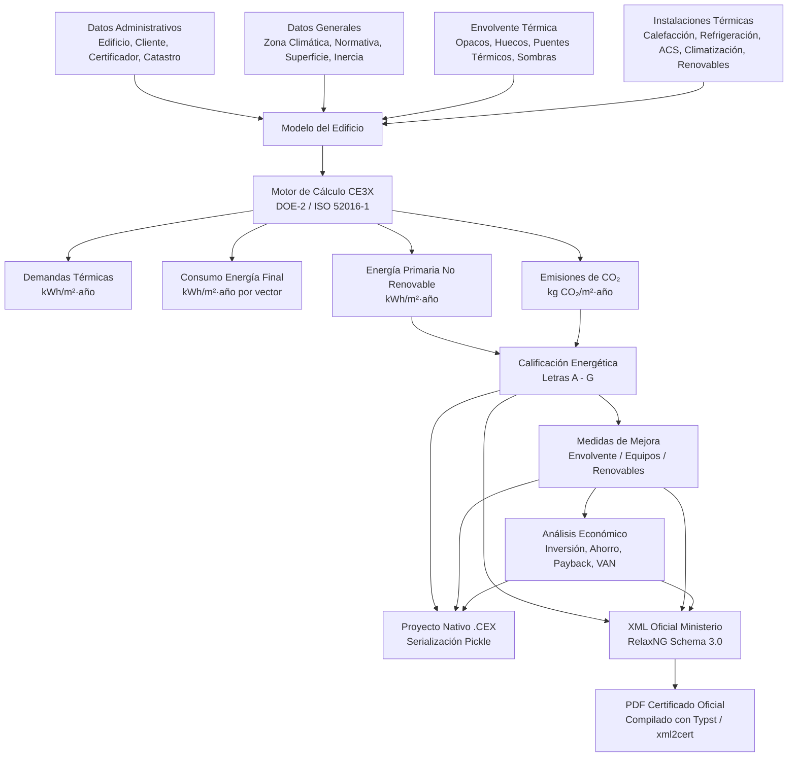
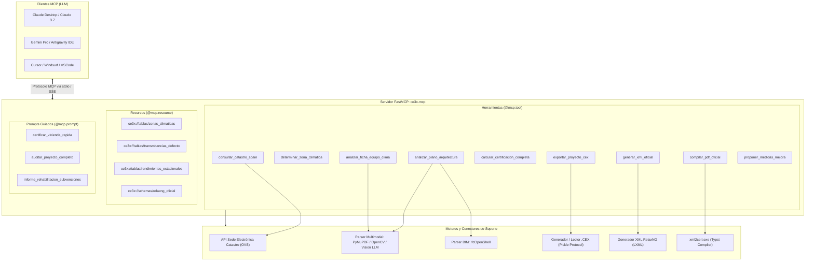

# 📋 Análisis Exhaustivo de CE3X v3.2 y Diseño de Arquitectura para Servidor MCP Oficial de Certificación Energética

---

## 1. Resumen Ejecutivo y Visión del Proyecto

### 1.1. Objetivo Principal
Crear un servidor **Model Context Protocol (MCP)** de alto rendimiento, abierto y modular (denominado provisionalmente `mcp-ce3x` o `ce3x-mcp`), desarrollado en **Python con el framework FastMCP**, que permita a modelos de inteligencia artificial (Claude, Gemini, ChatGPT/Cursor/Antigravity) actuar como un **asistente técnico experto en Certificación de Eficiencia Energética (CEE) de Edificios en España** bajo el marco del **Real Decreto 390/2021** y el **Código Técnico de la Edificación (CTE DB-HE)**.

### 1.2. Capacidades Clave a Habilitar en las IAs
1. **Certificación Ultrarrápida a partir de Datos Mínimos:** Capacidad de generar una calificación completa y rigurosa con apenas 4-5 datos clave (Referencia catastral o municipio + año de construcción + superficie útil + tipo de calefacción/ACS), infiriendo con precisión normativa todos los valores por defecto oficiales del CTE / NBE-CT-79.
2. **Ingesta Multimodal Avanzada:** Lectura y comprensión de:
   - **Planos arquitectónicos de distribución (PDF / CAD / BIM IFC):** Extracción automatizada de superficies útiles, perímetros, alturas libres, orientaciones de fachadas y áreas de huecos.
   - **Fichas técnicas y fotografías de equipos:** Reconocimiento de bombas de calor, calderas, sistemas VRF, aislamientos y carpinterías/vidrios para extraer potencias, rendimientos nominales y estacionales (COP, SCOP, EER, SEER).
3. **Generación de Entregables Oficiales y Registro Telemático:**
   - Creación del archivo oficial de proyecto **`.cex`** para poder abrirlo, auditarlo y recalcularlo directamente en el software CE3X v3.2.
   - Generación del archivo oficial **`.xml`** de intercambio normalizado (`DatosEnergeticosDelEdificio version 3.0`), validado contra el esquema **RelaxNG** del Ministerio.
   - Generación del **Certificado Oficial en PDF** mediante el compilador `xml2cert` (con tecnología Typst).
4. **Propuesta Inteligente de Medidas de Mejora y Análisis Económico:** Formulación automática de paquetes de rehabilitación (SATE, carpinterías, aerotermia, fotovoltaica) con estimación de salto de letra energética, inversión aproximada, subvenciones NextGen e IRPF, y periodo de retorno económico (Payback / VAN).

---

## 2. Análisis Exhaustivo del Software CE3X v3.2

### 2.1. Naturaleza y Homologación Oficial
* **Desarrolladores:** Consorcio formado por **Efinovatic** y el **CENER** (Centro Nacional de Energías Renovables) para el **IDAE** (Instituto para la Diversificación y Ahorro de la Energía) y el Ministerio de Vivienda / Ministerio para la Transición Ecológica y el Reto Demográfico (MITERD).
* **Estatus Normativo:** Documento Reconocido Oficial para la certificación energética de edificios existentes y adaptado para comprobaciones del CTE DB-HE.
* **Ubicación de la Instalación Analizada:** `C:\Program Files (x86)\CE3Xv3.2\`.

### 2.2. Arquitectura de Software Interna
Al desensamblar e inspeccionar los componentes de la instalación, se constatan los siguientes detalles técnicos:
* **Entorno de Ejecución:** Aplicación compilada originalmente sobre Python 2.7 congelado mediante `py2exe` y extensiones binarias en C/Cython (`.pyd`).
* **Interfaz de Usuario (GUI):** Desarrollada con `wxPython` (`wxmsw30u_core_vc90.dll`).
* **Librerías Científicas Base:** `numpy` (1.x con OpenBLAS), `scipy`, `matplotlib`, `shapely`, `Polygon2`.
* **Motor Dual de Cálculo:**
  1. **Motor Simplificado Tradicional (`Calculos\`, `BD\`):** Basado en matrices de resultados precalculados con DOE-2 / Calener para 32 zonas climáticas peninsulares e insulares (`Base_datos_A1c.bin`, `Base_datos_D3.bin`, etc.), empleando coeficientes de ponderación de demanda adimensionalizada.
  2. **Motor Horario Avanzado UNE-EN ISO 52016-1 (`CalculosISO52016\ISO52016\`):** Implementación de la norma internacional **ISO 52016-1** para simulación horaria de la demanda térmica de calefacción y refrigeración, con perfiles horarios de ocupación, ventilación, sombras dinámicas y climas horarios (`clima.dump`, `calendarios.dump`).
* **Módulo de Intercambio y Registro Oficial (`moduloXML\`):**
  - Contiene la herramienta oficial del Instituto Eduardo Torroja (IETcc-CSIC) `xmlcert_20260703` desarrollada por Rafael Villar Burke, Daniel Jiménez González y Marta Sorribes Gil.
  - Esquema RelaxNG: `DatosEnergeticosDelEdificioSchema30-full.rng` y `.rnc`.
  - Compilador de PDF oficial: `xml2cert.exe`, que integra internamente el motor tipográfico **Typst 0.13.1** para producir el documento PDF homologado con diseño limpio y gráficos vectoriales.
  - Validador oficial: `xmlcheck.exe` (con soporte para `jing.jar`).

### 2.3. Estructura de Datos y Flujo Funcional del Programa



### 2.4. Módulos y Parámetros del Software

| Módulo CE3X | Parámetros Principales de Entrada | Fuentes de Datos y Criterios |
| :--- | :--- | :--- |
| **Datos Administrativos** | Nombre edificio, dirección, provincia, municipio, código postal, referencia catastral (DGC / Foral), alcance (todo el edificio / vivienda individual / parte), datos del técnico y titulación. | Catastro (Sede Electrónica) o datos del cliente. |
| **Datos Generales** | Tipología (Unifamiliar, Bloque, Terciario), Normativa vigente (Anterior 1979, NBE-CT-79, CTE 2006, CTE 2013, CTE 2019), Zona climática ($\alpha1..\alpha4, A1..E1$), Superficie útil habitable ($m^2$), Altura libre media ($m$), Número de plantas, Inercia térmica (Baja, Media, Alta), Caudal de ventilación ($n_{50}$ / renovaciones/h). | Planos de planta, consulta catastral y tablas climáticas del CTE DB-HE. |
| **Envolvente: Opacos** | Tipo de cerramiento (Fachada aire, Fachada terreno, Medianera, Cubierta plana/inclinada, Suelo solera/sanitario, Partición interior no habitable), Orientación (N, S, E, O, etc.), Superficie ($m^2$), Longitud y altura, Transmitancia $U$ ($W/m^2K$), Masa ($kg/m^2$). Métodos: Por defecto (por año), Estimado (por capas/aislamiento), Conocido. | Manual de fundamentos técnicos CE3X / Fichas NBE-CT-79 / CTE. |
| **Envolvente: Huecos** | Longitud, altura, multiplicador, Orientación, Tipo de vidrio (simple, doble estándar, bajo emisivo), Tipo de marco (metálico sin RPT, con RPT, madera, PVC), % de marco, Permeabilidad al aire (100, 50, 27, 9 $m^3/h\cdot m^2$), Protecciones solares (voladizos, retranqueos, lamas, toldos, persianas). | Fichas técnicas de ventanas o marcado CE. |
| **Puentes Térmicos** | Encuentro fachada-forjado, esquinas entrantes/salientes, contorno de huecos, cajas de persiana, pilares integrados. Puede ser "Por defecto" (calculado automáticamente según superficie y normativa) o "Usuario" con longitud ($m$) y transmitancia lineal $\psi$ ($W/mK$). | Cálculo geométrico o catálogo del CTE. |
| **Patrones de Sombra** | Obstáculos remotos (edificios cercanos, montañas). Definición por ángulos de elevación y azimut o polígonos de sombras. | Levantamiento visual o cartografía 3D. |
| **Instalaciones Térmicas** | **ACS:** Demanda diaria (l/día a 60°C), tipo de equipo (termo, caldera, bomba de calor), combustible, rendimiento nominal o estacional, acumulación.<br>**Calefacción:** Caldera (estándar, baja temp, condensación, biomasa), efecto Joule, bomba de calor; potencia nominal ($kW$), rendimiento/COP, cobertura de demanda (%).<br>**Refrigeración:** Bomba de calor, split, multi-split, VRF; potencia frigorífica, EER/SEER.<br>**Sistemas Mixtos:** Calderas combinadas calefacción + ACS.<br>**Renovables:** Contribución solar térmica (% o kWh/año), Fotovoltaica (potencia pico kWp, producción anual kWh/año, % autoconsumo). | Fichas técnicas de fabricantes (Daikin, Mitsubishi, Saunier Duval, Baxi, Vaillant, etc.). |
| **Calificación Final** | Demanda de calefacción y refrigeración ($kWh/m^2a$), Consumo de energía primaria no renovable ($CEP_{nr}$), Emisiones de $CO_2$ ($kg CO_2/m^2a$). Letras globales y parciales (A, B, C, D, E, F, G). | Fórmulas oficiales de escala según tipología y zona climática (`Localidades.xml`). |
| **Medidas de Mejora** | Definición de medidas individuales o paquetes combinados: adición de SATE (5-10 cm), sustitución de ventanas por doble vidrio bajo emisivo con PVC, sustitución de caldera/termo por Aerotermia de alta eficiencia (SCOP > 3.5), instalación fotovoltaica (2-4 kWp). Recálculo de la calificación y % de reducción de energía primaria no renovable y emisiones. | RD 390/2021 y convocatorias de ayudas (Next Generation / PREE). |
| **Análisis Económico** | Coste estimado de cada medida (€), coste de energía actual vs mejorado, ahorro anual (€/año), periodo de retorno simple y descontado (Payback), Tasa Interna de Retorno (TIR), Valor Actual Neto (VAN). | Precios de mercado / bases de precios (ej. BEDEC / Generador de Precios CYPE). |

---

## 3. Análisis de los Manuales Oficiales (IDAE / Efinovatic / CENER)

De la lectura minuciosa de los 3 manuales oficiales ubicados en `Manuales\`:

### 3.1. Manual de Usuario (259 páginas)
* **Filosofía de entrada de datos:** CE3X está diseñado para trabajar con **tres niveles de información**:
  1. *Por defecto:* El programa asume los valores máximos permitidos por la normativa vigente en el año de construcción del edificio. Es el método más rápido pero el más conservador (suele arrojar calificaciones E, F o G).
  2. *Estimado:* El técnico aporta datos cualitativos (por ejemplo: "muro de doble hoja con cámara de aire y 4 cm de aislamiento de poliestireno", o "vidrio doble con cámara de 12 mm y marco de aluminio con RPT"). El software calcula la transmitancia equivalente $U$.
  3. *Conocido / Justificado:* El técnico introduce directamente la transmitancia térmica $U$ ensayada o calculada en proyecto, el factor solar $g$, o el rendimiento estacional ensayado del equipo térmico.
* **Aspectos clave de zonificación:** Para residencial, el edificio o vivienda se considera una única zona térmica acondicionada. Los espacios no habitables (garajes, trasteros, bajo cubiertas) no se modelizan geométricamente, sino como particiones en contacto con espacios no habitables mediante coeficientes de reducción de temperatura ($b$).

### 3.2. Manual de Fundamentos Técnicos (212 páginas)
* **Adimensionalización de variables globales:**
  - $UA_{global} = \sum (U_i \cdot A_i \cdot b_i) + \sum (\psi_k \cdot L_k)$ (Transmitancia total de la envolvente).
  - Coeficiente de intercambio de aire por ventilación e infiltraciones: basado en la permeabilidad al aire de huecos y estanqueidad de la envolvente.
  - Inercia térmica específica: masa por unidad de superficie ponderada de los cerramientos.
  - Factor solar equivalente ponderado de huecos con protecciones solares fijas (voladizos, retranqueos) y móviles (toldos, lamas, persianas).
* **Conversión de Energía Final a Primaria y Emisiones:**
  Factores oficiales de paso del IDAE vigentes:
  - Electricidad Peninsular: $CEP_{nr} = 1.954\ kWh_{EPnr}/kWh_{EF}$, $Factor\ CO_2 = 0.331\ kg CO_2/kWh_{EF}$.
  - Gas Natural: $CEP_{nr} = 1.195\ kWh_{EPnr}/kWh_{EF}$, $Factor\ CO_2 = 0.252\ kg CO_2/kWh_{EF}$.
  - Gasóleo: $CEP_{nr} = 1.179\ kWh_{EPnr}/kWh_{EF}$, $Factor\ CO_2 = 0.311\ kg CO_2/kWh_{EF}$.
  - Biomasa (pellets certificados): $CEP_{nr} = 0.085\ kWh_{EPnr}/kWh_{EF}$, $Factor\ CO_2 = 0.018\ kg CO_2/kWh_{EF}$.

### 3.3. Manual de Medidas de Mejora (14 páginas)
* Establece las pautas para justificar la viabilidad técnica y económica exigida por el RD 390/2021.
* Define cómo deben combinarse las medidas pasivas (envolvente) con las activas (instalaciones y renovables) para conseguir saltos de al menos 2 letras o reducciones de energía primaria superiores al 30% (umbral estándar para deducciones fiscales en el IRPF del 40% o 60% y ayudas NextGen).

---

## 4. Evaluación de Frameworks MCP: FastMCP vs Alternativas

Para conectar modelos como Gemini o Claude con este ecosistema, evaluamos las opciones tecnológicas:

| Criterio | FastMCP (Python) ⭐ | MCP SDK Oficial (TypeScript/Node) | MCP Low-Level (Python) |
| :--- | :--- | :--- | :--- |
| **Integración con Ecosistema AEC** | **Excepcional:** Acceso directo a `ifcopenshell` (BIM), `shapely` (geometría), `pymupdf` (PDF planos), `lxml` (RelaxNG). | **Mala:** Requiere microservicios externos o wrappers para librerías de arquitectura e ingeniería. | Media: Mismas librerías pero con código farragoso. |
| **Compatibilidad con CE3X** | **Nativa:** CE3X está escrito en Python; sus estructuras de datos, `.cex` (pickle) y librerías son directamente comprensibles en Python. | **Nula:** Deserializar pickles de Python 2/3 en Node.js es extremadamente frágil y costoso. | Nativa pero requiere boilerplate manual. |
| **Productividad y Claridad de Código** | **Máxima:** Decoradores sencillos `@mcp.tool()`, `@mcp.resource()`, `@mcp.prompt()`. Validación Pydantic v2 automática de argumentos. | Buena para herramientas web, pero verbosa para pipelines de ingeniería. | Baja: Gestión manual de JSON-RPC, serialización de tipos y esquemas JSON Schema. |
| **Distribución al Usuario Final** | **Ultraligera:** Se puede ejecutar con `uvx ce3x-mcp` o `pip install ce3x-mcp` directamente en Windows, macOS o Linux. | Requiere entorno Node.js / `npx`. | Requiere entorno Python pero sin la facilidad de empaquetado de FastMCP. |
| **Soporte de Transportes** | `stdio` (Desktop Claude / Antigravity IDE / Cursor) y `SSE` / `HTTP` (servidores en la nube). | `stdio` y `SSE`. | `stdio` y `SSE`. |

> [!TIP]
> **Conclusión Técnica:** **Python con FastMCP es indiscutiblemente la mejor elección tecnológica.** Permite unificar en un único proyecto la lógica MCP, el parsing de planos (BIM/PDF), el procesado de fichas técnicas con OCR/IA, la validación XML y la integración con las herramientas oficiales de certificación.

---

## 5. Arquitectura del Servidor MCP Propuesto: `mcp-ce3x`



### 5.1. Catálogo Detallado de Herramientas MCP (`@mcp.tool`)

1. **`consultar_catastro_spain(referencia_catastral, provincia, municipio, direccion)`**:
   - Conecta con la API oficial de la Sede Electrónica del Catastro (WFS / OVS pública de España).
   - Devuelve automáticamente: año exacto de construcción, superficie construida catastral, uso principal (residencial unifamiliar o colectivo), planta, coeficiente de participación y geometría en coordenadas INSPIRE.
2. **`determinar_zona_climatica(provincia, municipio, altitud)`**:
   - Aplica la tabla de capitales y corrección por altitud del **CTE DB-HE 2019** (Apéndice B).
   - Devuelve la zona climática peninsular o insular (ej. Madrid a 667m $\rightarrow$ D3; A Coruña a 20m $\rightarrow$ C1; Granada a 738m $\rightarrow$ D3).
3. **`estimar_envolvente_por_defecto(ano_construccion, tipologia, superficie_util)`**:
   - Aplica los valores reglamentarios de los manuales de fundamentos técnicos de CE3X según la época del edificio (anterior a 1979, NBE-CT-79, CTE 2006, CTE 2013, CTE 2019).
   - Estima transmitancias $U$ de fachadas, cubiertas, soleras y ventanas, masa e inercia térmica, y permeabilidad al aire.
4. **`analizar_plano_arquitectura(archivo_path_o_imagen)`**:
   - Procesa planos de distribución (PDF vectorial, imagen PNG/JPG o archivo IFC).
   - Extrae superficies útiles por estancia, longitud de fachadas expuestas al exterior, orientaciones cardinales, y cuadro de carpinterías (ancho $\times$ alto de ventanas).
5. **`analizar_ficha_equipo_clima(texto_o_imagen)`**:
   - Parsea fichas técnicas de fabricantes (catálogos de aerotermia, calderas, bombas de calor, termos).
   - Extrae: tecnología, combustible, potencia térmica nominal ($kW$), rendimiento estacional (SCOP / SEER / $\eta$).
6. **`calcular_calificacion_energetica(datos_proyecto)`**:
   - Ejecuta el motor de balance térmico y factores de conversión oficial.
   - Devuelve: demandas de calefacción y refrigeración ($kWh/m^2a$), consumos de energía final por vector, consumo de energía primaria no renovable ($CEP_{nr}$), emisiones de $CO_2$ ($kg CO_2/m^2a$) y letras de calificación (A a G).
7. **`exportar_archivo_cex(datos_proyecto, ruta_salida)`**:
   - Genera el fichero nativo `.cex` estructurado para que el usuario pueda abrirlo en la interfaz gráfica oficial de CE3X v3.2.
8. **`generar_xml_oficial_registro(datos_proyecto, ruta_salida)`**:
   - Genera el archivo XML conforme a la especificación oficial `DatosEnergeticosDelEdificio version 3.0`.
   - Realiza la validación sintáctica y semántica contra el esquema RelaxNG oficial (`DatosEnergeticosDelEdificioSchema30-full.rng`) mediante `lxml`.
9. **`compilar_pdf_certificado(xml_path, out_dir)`**:
   - Ejecuta `xml2cert.exe` para compilar el PDF oficial de 8 a 15 páginas, incluyendo etiqueta de calificación energética, anexo de envolvente, anexo de instalaciones, anexo de medidas de mejora y pruebas in situ.
10. **`proponer_medidas_mejora(datos_proyecto, objetivo_ahorro_pct)`**:
    - Formula automáticamente los 3 paquetes de medidas de mejora requeridos por el RD 390/2021:
      - *Medida 1 (Envolvente):* Incorporación de SATE en fachadas y carpinterías con rotura de puente térmico y vidrio bajo emisivo.
      - *Medida 2 (Instalaciones):* Sustitución del sistema térmico por Bomba de Calor Aerotérmica para ACS y climatización.
      - *Medida 3 (Combinada + Renovables):* Envolvente + Aerotermia + Instalación Solar Fotovoltaica en autoconsumo.
    - Calcula el nuevo consumo, nueva letra, coste orientativo (€), ahorro anual (€/año) y periodo de retorno simple/descontado.

---

## 6. Limitaciones, Requisitos Técnicos y Mitigaciones

1. **Permisos en Windows (`Program Files`):**
   * *Limitación:* La carpeta `C:\Program Files (x86)\CE3Xv3.2` es de solo lectura para usuarios no administradores (`Acceso denegado`).
   * *Mitigación:* El proyecto MCP se desarrollará en un repositorio externo e independiente (ej. en el espacio de trabajo GitHub del usuario), accediendo a los binarios de CE3X (`xml2cert.exe`, tablas de clima) como recursos externos de solo lectura.
2. **Dependencia de Java en `xml2cert.exe` para validación RelaxNG:**
   * *Limitación:* Por defecto, `xml2cert.exe` intenta invocar `java -jar bin/jing.jar`. Si Java no está en el `PATH`, falla la compilación.
   * *Mitigación Probada con Éxito:*
     - En el sistema del usuario hemos verificado que existe un JRE funcional en `C:\Program Files\AutoFirma\AutoFirma\jre\bin\java.exe` y en Android Studio. El MCP puede inyectar temporalmente esta ruta al entorno o llamar a `xml2cert` con el runtime adecuado.
     - Adicionalmente, el MCP validará el XML de forma nativa en Python usando `lxml.etree.RelaxNG` antes de pasarlo a `xml2cert`, garantizando cero fallos de validación.
3. **Compatibilidad Python 2 vs Python 3 para `.cex`:**
   * *Limitación:* CE3X v3.2 fue compilado con Python 2.7 y guarda sus archivos `.cex` mediante `pickle` con protocolo 0 y clases internas compiladas (`Envolvente`, `Instalaciones`).
   * *Mitigación Probada:* Hemos desarrollado un `SafeUnpickler` en Python 3 que normaliza los saltos de línea Windows (`\r\n` $\rightarrow$ `\n`) y sustituye las clases internas por objetos deserializables transparentes. El MCP podrá tanto leer como escribir `.cex` válidos sin necesidad de ejecutar Python 2.7.

---

## 7. Recomendación sobre el Repositorio de GitHub

### ¿Es necesario crear un repositorio privado de GitHub desde el principio?
**Rotundamente SÍ. Es esencial por los siguientes motivos:**

1. **Separación de Responsabilidades:** `C:\Program Files (x86)\CE3Xv3.2` contiene binarios compilados de una aplicación de terceros. El código fuente de nuestro servidor MCP debe estar en su propio repositorio limpio, versionado y estructurado.
2. **Control de Versiones y Seguridad:** Permite registrar cada iteración, proteger tokens y configuraciones locales mediante `.gitignore`, y mantener el historial de decisiones arquitectónicas.
3. **Distribución Sencilla:** Una vez estructurado en GitHub, cualquier usuario o cliente podrá instalar y usar el MCP ejecutando simplemente:
   ```bash
   uvx --from git+https://github.com/tu-usuario/mcp-ce3x mcp-ce3x
   ```
4. **Cumplimiento Estricto de la Guía de Estilo Oficial de JMCG:**
   El repositorio se estructurará desde el primer commit siguiendo la guía oficial del usuario (`guia_estilo_README.md`):
   - Cabecera en tabla de 2 columnas (`🏗️ Perfil & ConTech` | `📈 Repositorio & Enlaces`).
   - Badges de Shields.io con el parámetro obligatorio `style=plastic` (relieve 3D).
   - Bloques informativos `> [!IMPORTANT]`, tablas de módulos con iconos temáticos y firma oficial de autor.

---

## 8. Hoja de Ruta de Implementación Propuesta (Roadmap)

- [ ] **Fase 0: Inicialización del Repositorio**
  - [ ] Crear repositorio privado en GitHub (ej. `mcp-ce3x` o `ce3x-mcp`) en `c:\Users\Jose\OneDrive\GITHUB\mcp-ce3x`.
  - [ ] Configurar `.gitignore` (excluyendo entornos virtuales, cachés y la carpeta `NOTAS/`).
  - [ ] Inicializar `pyproject.toml` con soporte para Python 3.11+, FastMCP, Pydantic, lxml, shapely, pymupdf.
  - [ ] Crear `NOTAS/NOTAS_1_JMCG.md` y `NOTAS/NOTAS_2_GEMINI.md` en el nuevo repositorio.

- [ ] **Fase 1: Núcleo de Datos y Fórmulas Normativas (Core Engine)**
  - [ ] Módulo de consulta a Catastro (Sede Electrónica / OVS) para datos de inmueble automáticos.
  - [ ] Tablas oficiales de zonas climáticas CTE DB-HE y conversiones energéticas/emisiones.
  - [ ] Generador y validador de XML oficial `DatosEnergeticosDelEdificio version 3.0` contra RelaxNG.
  - [ ] Conector con `xml2cert.exe` para generación automática del PDF oficial del certificado.
  - [ ] Lector y escritor bidireccional del formato nativo `.cex` de CE3X.

- [ ] **Fase 2: Implementación del Servidor FastMCP**
  - [ ] Configurar servidor FastMCP con transportes `stdio` y `sse`.
  - [ ] Implementar `@mcp.tool` para datos mínimos, cálculo y generación de entregables.
  - [ ] Implementar `@mcp.resource` para catálogos normativos, transmitancias y factores solares.
  - [ ] Implementar `@mcp.prompt` para los flujos asistidos de certificación y auditoría.

- [ ] **Fase 3: Módulo de Ingesta Multimodal (Planos y Fichas)**
  - [ ] Parser de planos arquitectónicos (PDF/imagen): extracción de áreas de recintos, fachadas y huecos.
  - [ ] Soporte para modelos BIM IFC (`ifcopenshell`) para cubicación directa de la envolvente térmica.
  - [ ] Parser de fichas técnicas de climatización/ventanas (extracción de potencias, COP/SCOP/EER).

- [ ] **Fase 4: Motor de Medidas de Mejora y Análisis Económico**
  - [ ] Generación automática de paquetes de mejora (SATE, carpinterías, aerotermia, fotovoltaica).
  - [ ] Cálculo de nuevo consumo, ahorro porcentual y salto de letra.
  - [ ] Estimación de presupuesto de ejecución, amortización y deducciones IRPF / ayudas NextGen.

- [ ] **Fase 5: Documentación Oficial, Pruebas y Despliegue**
  - [ ] Redacción del `README.md` oficial bajo la Guía de Estilo JMCG (badges `style=plastic`, 2 columnas).
  - [ ] Batería de pruebas con los 5 ejemplos oficiales de CE3X (`1 Bloque de viviendas.cex`, `3 Pequeno terciario.cex`, etc.).
  - [ ] Guía de instalación y configuración en Claude Desktop, Antigravity IDE y Cursor.
